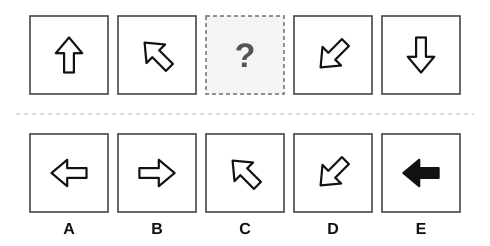
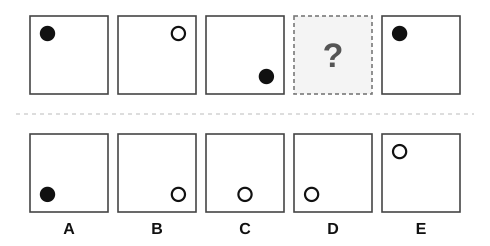
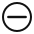
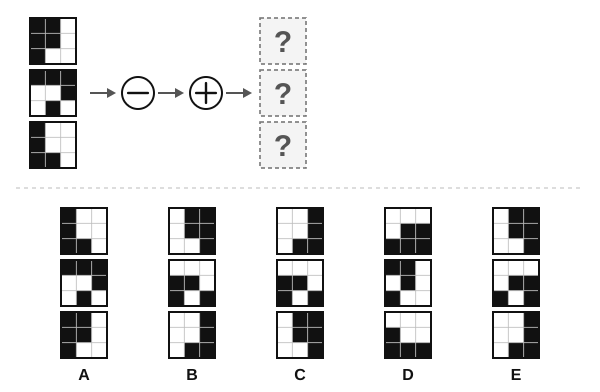
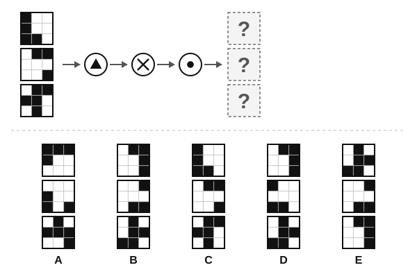
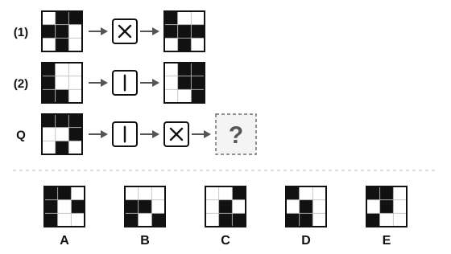
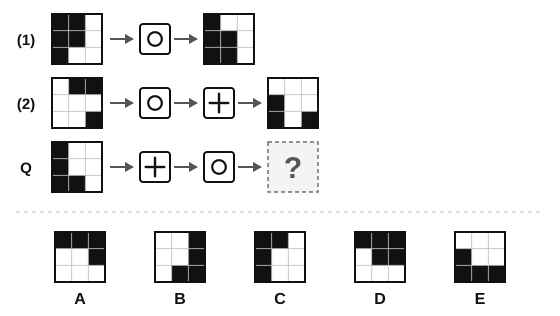

<!-- nav:top -->[目次](../README.md#目次) · 前へ：[CABとは](test-overview.md) · 次へ：[暗算（四則逆算）](sections/anzan.md)<!-- /nav:top -->

# 15分診断テスト

4科目から2問ずつ、全8問です。どの科目から対策を始めるべきかを決めるためのテストなので、時間を計って、わからない問題も何か1つ選んでください。目安は15分です。

この8問はこのガイドのために作ったオリジナル問題です。日本SHLの問題や他の対策本・サイトの問題ではありません。

## パートA 暗算（四則逆算）

紙とペンを使わず、頭の中だけで解いてください。

**問1.** 48 × 15 = ?

A. 600 · B. 680 · C. 720 · D. 760 · E. 820

**問2.** 3.6 × □ = 27

A. 6.5 · B. 7.5 · C. 8 · D. 9.7 · E. 75

答えと解説（問1・問2）

**問1：C、720。** 15を「10 + 5」に分けます。48 × 10 = 480、48 × 5 = 240、合わせて720です。*Aではない理由：* 600は 40 × 15 で、48を40に丸めすぎています。

**問2：B、7.5。** □ = 27 ÷ 3.6。両方を10倍して 270 ÷ 36 = 7.5 です。*Eではない理由：* 75は小数点の位置を1つずらしたミスです。3.6 × 75 は 270 で、27の10倍になります。

## パートB 法則性

上段の「?」に入る図形を、下段のA〜Eから選んでください。

**問3.**

**問4.**

答えと解説（問3・問4）

**問3：A。** 矢印が反時計回りに45°ずつ回っています（上、左上、?、左下、下）。3番目は左向きです。*Bではない理由：* 右向きは時計回りに回した向きです。*Dではない理由：* 左下向きは4番目と同じで、1回分進みすぎです。

**問4：D。** 丸は外周を時計回りに2か所ずつ進み（左上、右上、右下、?、左上）、色は黒と白が交互に変わります。4番目は左下の白い丸です。*Aではない理由：* 位置は合っていますが黒です。*Cではない理由：* 下の中央は、1か所しか進めていない位置です。

## パートC 命令表

次の命令表を使って、命令をすべて実行したあとの並びを選んでください。図形は上段・中段・下段の3つです。

| 記号 | 命令 |
|---|---|
|  | 上段と下段の図形を入れ替える |
|  | すべての図形を時計回りに90°回転させる |
|  | すべての図形の白黒を反転させる |
|  | 中段の図形だけを左右反転させる |
|  | 図形を1つずつ上へずらす（上段の図形は下段へ） |
|  | 直後の命令を2回続けて実行する |

**問5.**

**問6.**

答えと解説（問5・問6）

**問5：B。** 横線の丸ですべての白黒を反転し、十字の丸で上段と下段を入れ替えます。*Aではない理由：* 入れ替えだけで、白黒反転をしていません。*Cではない理由：* 白黒反転だけで、入れ替えていません。

**問6：B。** 三角の丸は直後の×の丸を2回実行するので、すべての図形が時計回りに180°回ります。そのあと点の丸で、中段だけを左右反転します。*Aではない理由：* ×の丸を1回しか実行していません。*Dではない理由：* 中段の左右反転を忘れています。

## パートD 暗号

（1）（2）の例から各記号の意味を読み取り、Qの「?」に入る図形を選んでください。記号の意味は問題ごとに独立しています。変化は「時計回りに90°回転」「反時計回りに90°回転」「180°回転」「左右反転」「上下反転」「白黒反転」のどれかです。

**問7.**

**問8.**

答えと解説（問7・問8）

**問7：C。** 例（1）から×の箱は「反時計回りに90°回転」、例（2）から縦線の箱は「白黒反転」です。Qは白黒を反転してから、反時計回りに90°回します。*Eではない理由：* ×の箱を時計回りと読み違えた形です。*Aではない理由：* 白黒をもう一度反転させてしまい、回転だけをした形になっています。

**問8：E。** 例（1）から輪の箱は「上下反転」です。例（2）は輪の箱のあとに十字の箱があり、上下反転した図形を時計回りに90°回すと右の図形になるので、十字の箱は「時計回りに90°回転」です。Qは時計回りに90°回してから上下反転します。*Aではない理由：* 十字の箱を反時計回りと読み違えた形です。*Cではない理由：* 十字の箱を飛ばし、上下反転だけをした形です。

## 結果の見方

| 問 | 1 | 2 | 3 | 4 | 5 | 6 | 7 | 8 |
|---|---|---|---|---|---|---|---|---|
| 科目 | 暗算 | 暗算 | 法則性 | 法則性 | 命令表 | 命令表 | 暗号 | 暗号 |
| 答え | C | B | A | D | B | B | C | E |

科目ごとに正解数を数えてください。

| 科目の正解数 | 意味 | 次にやること |
|---|---|---|
| 2問 | 基本の型はできている | 本番形式で時間を計って解く |
| 1問 | 型があいまい | その科目のページの「解き方の手順」と「落としやすいポイント」を読む |
| 0問 | 形式に慣れていない | その科目のページを最初から読み、練習問題5問を解く |

正解数が少ない科目から対策を始めてください。同じ数なら、命令表と暗号を先にするのがおすすめです。初見での戸惑いが大きく、練習による伸びも大きい科目だからです。

- [暗算（四則逆算）](sections/anzan.md)
- [法則性](sections/housokusei.md)
- [命令表](sections/meireihyou.md)
- [暗号](sections/angou.md)

本番に近い長さで力を測りたいときは、[CAB形式の無料模擬テスト（PrepClubs）](https://prepclubs.com/ja/cab-taisaku?utm_source=github&utm_medium=referral&utm_campaign=study-notes&utm_content=cab)も使えます。

---

<!-- nav:bottom -->← 前へ：[CABとは](test-overview.md) | 次へ：[暗算（四則逆算）](sections/anzan.md) → | [目次へ戻る](../README.md#目次)<!-- /nav:bottom -->
