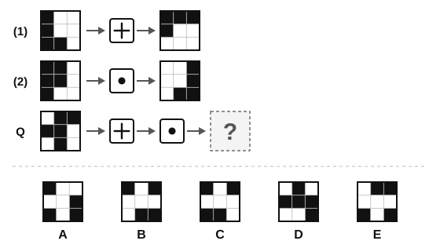
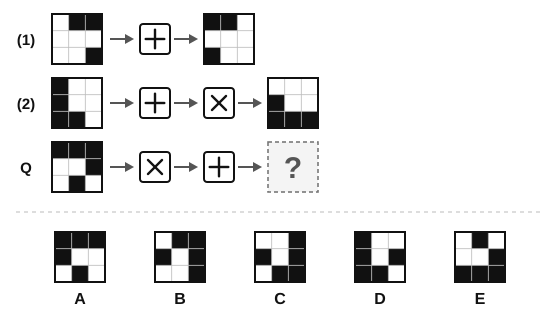
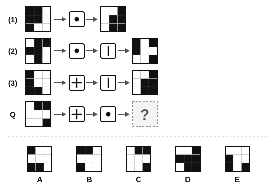
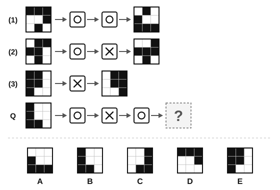
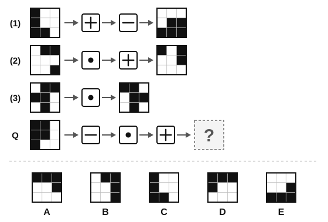

<!-- nav:top -->
[目次](../../README.md#目次) · 前へ：[命令表](meireihyou.md) · 次へ：[性格検査（OPQ）](../personality.md)
<!-- /nav:top -->

# 暗号

**ひとことで言うと：** 図形が記号を通ると形が変わる、という例をいくつか見て、各記号が何をするのかを推理し、新しい図形が記号を通ったあとの形を答える科目です。

日本SHLは暗号を、表面に現れている事象から背後に隠された構造や関係を推理する能力を測る科目だと説明しています。複雑なシステム設計への適性や、プログラムのミスを見つける（デバッグ）力にもつながるとしています。命令表と違って記号の意味は教えてもらえず、自分で解読する必要があります。

## 何を測る科目か

見ているのは「入力と出力から処理の中身を推理する力」です。中身の見えない関数に値を入れて、返ってきた値から何をしているかを当てるのに似ています。わかっている記号から先に確定させ、その知識を使って残りを解くという順序立てができるかがポイントです。

## 問題の形

いくつかの「例」が示されます。左の図形が矢印に沿って記号の箱を通り、右の図形に変わります。記号が2つ続く例もあります。例から各記号の意味を読み取り、最後の行（Q）の「?」に入る図形をA〜Eから選びます。

本番の暗号の図は、複数の経路が組み合わさった形になっていることが多いとされます。このガイドでは、1つの考え方を確実に身につけるため、1問ごとに短い例を並べた形にしています。

## このページの記号と変化の種類

このページの練習問題では、記号は次の6つの絵のどれかで、意味は問題ごとに変わります。

     

1つの記号が表す変化は、次の6種類のどれか1つです。

| 変化 | 内容 |
|---|---|
| 時計回りに90°回転 | 図形全体を右回りに4分の1回す |
| 反時計回りに90°回転 | 図形全体を左回りに4分の1回す |
| 180°回転 | 図形全体を半回転させる |
| 左右反転 | 縦の線を鏡にして、左右を入れ替える |
| 上下反転 | 横の線を鏡にして、上下を入れ替える |
| 白黒反転 | 黒いマスと白いマスをすべて入れ替える |

図形は3×3のマス目です。回転と反転は形が似て見えることがあるので、黒いマスの1つに目印をつけて、その位置がどこへ移ったかで判断します。

## 解き方の手順

1. **記号が1つだけの例から読む。** 記号1つで変化している例は、その記号の意味を直接教えてくれます。ここから確定させます。
2. **白黒が変わったかを最初に見る。** 黒いマスの数が変わっていれば白黒反転が入っています。数が同じなら、回転か反転です。
3. **回転か反転かを、目印のマスで決める。** 角にある黒いマスなど、1つのマスがどこへ移ったかを見ます。左上が右上へ移ったなら、時計回り90°か左右反転です。もう1つのマスで、どちらかを決めます。
4. **記号が2つの例は、わかっている方を先に外す。** 一方の記号の意味がわかっていれば、その変化を取り除いた残りが、もう一方の記号の意味です。
5. **Qを1記号ずつ実行する。** 矢印の順に1つずつ変化させます。回転と反転が混ざるときは、順番を入れ替えると結果が変わるので注意します。

## 落としやすいポイント

- **左右反転と90°回転の混同。** 1つのマスだけを見ると同じ位置に移ることがあります。必ず2つ以上のマスで確かめます。
- **上下反転と180°回転の混同。** 形によっては似て見えます。左右の位置関係が保たれているか（上下反転）、入れ替わっているか（180°回転）を見ます。
- **順番の入れ替え。** 「回転してから反転」と「反転してから回転」は、一般に結果が違います。
- **白黒反転のし忘れ。** 形の変化に気を取られて、最後に白黒を反転し忘れるミスがよくあります。
- **2回の変化をまとめ間違える。** 反時計回り90°を2回なら180°回転、左右反転を2回なら元どおりです。

## 時間の目安

暗号は1問あたり30秒前後とされ、4科目の中では比較的時間があります（非公式の情報は[Web-CAB・紙のCAB・C-CABの違い](../formats.md)を参照）。ただし、記号の意味を確定させる最初の段階で時間がかかりやすいので、1つの記号に20秒以上かけないようにします。

## 練習問題

この5問はこのガイドのために作ったオリジナル問題です。日本SHLの問題や他の対策本・サイトの問題ではありません。各問の（1）〜（3）が例、Qが問題です。記号の意味は問題ごとに独立しています（前の問題の意味を引き継ぎません）。

### 問1

### 問2

### 問3

### 問4

### 問5

答えと解説（問1〜問5）

**問1：C。** 例（1）から十字の箱は「時計回りに90°回転」、例（2）から点の箱は「白黒反転」です（黒いマスの数が変わっています）。Qは、図形を時計回りに90°回してから白黒を反転させた形です。*Dではない理由：* 回転はしていますが、白黒反転を忘れています。*Eではない理由：* 十字の箱を反時計回りと読み違えた形です。

**問2：D。** 例（1）から十字の箱は「左右反転」です。例（2）は十字の箱のあとに×の箱があり、左右反転した図形をさらに時計回りに90°回すと右の図形になるので、×の箱は「時計回りに90°回転」です。Qは順番が逆で、先に時計回りに90°回してから左右反転します。*Aではない理由：* ×の箱を飛ばし、左右反転だけをした形です。*Bではない理由：* ×の箱を反時計回りと読み違えた形です。*Cではない理由：* 回転だけで、左右反転をしていません。

**問3：B。** 例（1）から点の箱は「180°回転」です。例（2）は点の箱のあとに縦線の箱があり、180°回した図形の白黒を反転すると右の図形になるので、縦線の箱は「白黒反転」です。例（3）は十字の箱のあとに縦線の箱（白黒反転）があります。右の図形の白黒を戻すと、左の図形を上下に反転した形になっているので、十字の箱は「上下反転」です。Qは上下反転してから180°回転させます。上下反転と180°回転を続けると、結果は左右反転と同じになります。*Aではない理由：* 十字の箱を飛ばし、180°回転だけをした形です。*Dではない理由：* 白黒を反転させてしまっています。Qに縦線の箱はありません。

**問4：C。** まず例（3）から×の箱は「左右反転」です。次に例（2）で、右の図形の左右反転を戻すと、左の図形を反時計回りに90°回した形になるので、輪の箱は「反時計回りに90°回転」です。例（1）の輪の箱2回は180°回転になっていて、この読みと矛盾しません（例（1）だけでは時計回りか反時計回りかを決められない点に注意）。Qは、反時計回りに90°回す、左右反転、もう一度反時計回りに90°回す、の順です。*Aではない理由：* 輪の箱を1回飛ばした形です。*Eではない理由：* 白黒を反転させてしまっています。

**問5：D。** 例（3）から点の箱は「左右反転」です。例（2）は点の箱のあとに十字の箱があり、左右反転した図形を時計回りに90°回すと右の図形になるので、十字の箱は「時計回りに90°回転」です。例（1）は十字の箱のあとに横線の箱があり、時計回りに90°回した図形の白黒を反転すると右の図形になるので、横線の箱は「白黒反転」です。Qは、白黒反転、左右反転、時計回りに90°回転の順です。*Eではない理由：* 点の箱を上下反転と読み違えた形です。*Bではない理由：* 最後にもう一度時計回りに回してしまっています。

もっと解きたい人へ：PrepClubsの無料CAB形式模擬テストは、暗算・法則性・命令表・暗号の4科目で全179問あり、全問に解説が付いています。[CAB形式の無料模擬テスト（PrepClubs）](https://prepclubs.com/ja/cab-taisaku?utm_source=github&utm_medium=referral&utm_campaign=study-notes&utm_content=cab)

## 採点表

| 問 | 1 | 2 | 3 | 4 | 5 |
|---|---|---|---|---|---|
| 答え | C | D | B | C | D |

- **5問正解：** 解読の順序立てができています。本番は経路が複雑になるので、記号1つの例を探す速さを上げましょう。
- **4問正解：** 外した問題で、どの記号の読みがずれたかを確認してください。回転と反転の取り違え（手順3）が最も多いミスです。
- **3問以下：** 手順1の「記号が1つだけの例から読む」を徹底し、記号の意味をメモに書いてからQに進む練習をしてください。

## 次のステップ

暗号は、解読の順番を決める練習でぐっと安定します。時間を計った通しの練習は[CAB形式の無料模擬テスト（PrepClubs）](https://prepclubs.com/ja/cab-taisaku?utm_source=github&utm_medium=referral&utm_campaign=study-notes&utm_content=cab)でできます。間違えた問題は、どの記号を読み違えたかをメモしておきましょう。

---

<!-- nav:bottom -->
← 前へ：[命令表](meireihyou.md) | 次へ：[性格検査（OPQ）](../personality.md) → | [目次へ戻る](../../README.md#目次)
<!-- /nav:bottom -->
