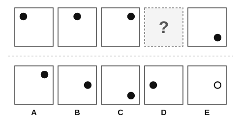
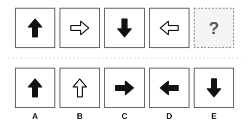
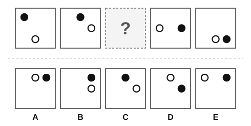
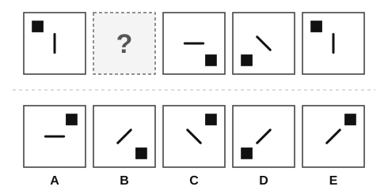
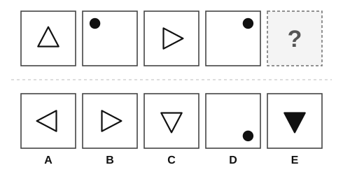

<!-- nav:top -->[目次](../../README.md#目次) · 前へ：[暗算（四則逆算）](anzan.md) · 次へ：[命令表](meireihyou.md)<!-- /nav:top -->

# 法則性

**ひとことで言うと：** 5つ並んだ図形のうち1つが空欄になっていて、並びの規則を見抜いて空欄に入る図形を選ぶ科目です。

日本SHLは法則性を、流れのある図形の並びから法則を速く正確に見分ける力、つまりプログラマーとしての優秀性を測る科目だと説明しています。規則そのものは単純なことが多いのですが、2つの規則が同時に動いていたり、1つおきに別の規則が並んでいたりすると、急に難しく感じます。

## 何を測る科目か

見ているのは「変化の規則を短時間で特定する力」です。プログラムのループで変数がどう変わるかを追うのと似ています。1つ目から2つ目、2つ目から3つ目へと、何が同じで何が変わったかを素早く比べられるかが勝負です。

## 問題の形

横一列に5つの枠が並び、そのうち1つが「?」になっています。下の選択肢A〜Eから、「?」に入る図形を選びます。空欄は最後とは限らず、真ん中や2番目のこともあります。

このガイドの練習問題で使う図形の要素は次のとおりです。

| 要素 | 変化のしかた |
|---|---|
| 丸（黒・白） | 枠の外周8か所（四隅と各辺の中央）を移動する |
| 矢印・三角 | 向きが45°や90°ずつ回る |
| 線 | 枠の中心を軸に回る |
| 小さな四角 | 四隅を移動する |
| 塗り | 黒と白が交互に入れ替わる |

## 解き方の手順

1. **要素を数える。** 各枠にいくつの部品があるか見ます。部品が2つあれば、規則も2つあると考えます。
2. **1つの部品だけを追う。** たとえば黒い丸だけを左から順に目で追い、「時計回りに1つずつ」のように言葉にします。
3. **残りの部品を同じように追う。** 2つ目の部品の規則を言葉にします。向き、位置、色のどれが変わっているかを分けて見ます。
4. **1つおきの並びを疑う。** 隣どうしで規則が見えないときは、1番目・3番目・5番目と、2番目・4番目に分けて見ます。
5. **空欄の前後の両方で確かめる。** 空欄が真ん中なら、左から進めた答えと、右から戻した答えが一致するか確かめます。
6. **選択肢を消していく。** 規則1に合わない選択肢を消し、残りから規則2で絞ります。

## 落としやすいポイント

- **回転の向きを取り違える。** 時計回りと反時計回りの選択肢は必ずと言っていいほど両方あります。最初の2枠で向きを確定させてから進めます。
- **進む量の見落とし。** 1つずつ進むのか、2つずつ進むのか。2枠分の動きで確かめます。
- **色の変化を見逃す。** 位置と向きが合っていても、黒と白が逆の選択肢があります。最後に色を確認します。
- **2つの部品を同時に追う。** 頭の中で混ざります。必ず1つずつ追ってください。
- **1つおきの規則に気づかない。** 図形の種類が交互に変わっていたら、まず1つおきの並びを疑います。

## 時間の目安

法則性は1問あたり20秒前後しかないとされています（非公式の情報は[Web-CAB・紙のCAB・C-CABの違い](../formats.md)を参照）。練習では、規則を言葉にするまでに10秒、選択肢を絞るのに10秒を目標にしてください。20秒たっても規則が見えない問題は、いったん選んで先に進みます。

## 練習問題

この5問はこのガイドのために作ったオリジナル問題です。日本SHLの問題や他の対策本・サイトの問題ではありません。上段の「?」に入る図形を、下段のA〜Eから選んでください。

### 問1

### 問2

### 問3

### 問4

### 問5

答えと解説（問1〜問5）

**問1：B。** 黒い丸が、枠の外周を時計回りに1か所ずつ進んでいます。左上、上の中央、右上と進んだので、4番目は右の中央です。5番目の右下にもつながります。*Aではない理由：* 右上は3番目と同じ位置で、動いていません。*Dではない理由：* 左の中央は反時計回りに進めた位置です。*Eではない理由：* 位置は合っていますが、丸が白になっています。

**問2：A。** 矢印は時計回りに90°ずつ回り、塗りは黒、白、黒、白と交互に変わります。4番目の左向き・白の次なので、5番目は上向き・黒です。*Bではない理由：* 向きは合っていますが白です。*Eではない理由：* 下向き・黒は3番目と同じで、回転が1回分足りません。

**問3：A。** 部品が2つあるので、1つずつ追います。黒い丸は時計回りに1か所ずつ（左上、上の中央、右上…）、白い丸は反時計回りに2か所ずつ（下の中央、右の中央、上の中央…）進みます。3番目は、黒が右上、白が上の中央です。4番目（黒が右の中央、白が左の中央）にもつながります。*Bではない理由：* 白い丸が2番目の位置のまま動いていません。*Cではない理由：* 2番目の枠と同じ図形です。*Eではない理由：* 白い丸が左上まで3か所進みすぎています。

**問4：E。** 線は時計回りに45°ずつ回り（縦、右上がり、横、右下がり、縦）、黒い四角は四隅を時計回りに1つずつ移ります（左上、右上、右下、左下、左上）。2番目は、右上がりの線と、右上の四角です。*Bではない理由：* 線は合っていますが、四角が右下で、2つ進んでいます。*Cではない理由：* 四角は合っていますが、線が右下がりで、逆向きに回しています。*Dではない理由：* 四角が左下で、反時計回りに進めています。

**問5：C。** 1つおきの規則です。1番目・3番目・5番目は白い三角で、上向き、右向きと時計回りに90°ずつ回ります。2番目・4番目は黒い丸で、左上から右上へ動いています。5番目は三角の並びなので、下向きの白い三角です。*Aではない理由：* 左向きは右向きから180°回した向きで、90°ずつの規則に合いません。*Dではない理由：* 丸の並びを続けてしまっています。*Eではない理由：* 向きは合っていますが、塗りが黒です。三角はずっと白のままです。

もっと解きたい人へ：PrepClubsの無料CAB形式模擬テストは、暗算・法則性・命令表・暗号の4科目で全179問あり、全問に解説が付いています。[CAB形式の無料模擬テスト（PrepClubs）](https://prepclubs.com/ja/cab-taisaku?utm_source=github&utm_medium=referral&utm_campaign=study-notes&utm_content=cab)

## 採点表

| 問 | 1 | 2 | 3 | 4 | 5 |
|---|---|---|---|---|---|
| 答え | B | A | A | E | C |

- **5問正解：** 規則を見抜く型はできています。本番は時間との勝負なので、1問20秒を目標にスピードを上げましょう。
- **4問正解：** 外した問題が「2つの部品」（問3・問4）か「1つおき」（問5）かを確認してください。どちらも手順2〜4で防げます。
- **3問以下：** 手順2の「1つの部品だけを追う」を徹底してください。規則を必ず短い言葉にしてから選択肢を見る癖をつけると、正答率が上がります。

## 次のステップ

法則性は、問題数をこなすほど「よくある規則」が頭に入ります。時間を計った通しの練習は[CAB形式の無料模擬テスト（PrepClubs）](https://prepclubs.com/ja/cab-taisaku?utm_source=github&utm_medium=referral&utm_campaign=study-notes&utm_content=cab)でできます。外した問題は、落としやすいポイントのどれに当たるかをメモしておきましょう。

---

<!-- nav:bottom -->← 前へ：[暗算（四則逆算）](anzan.md) | 次へ：[命令表](meireihyou.md) → | [目次へ戻る](../../README.md#目次)<!-- /nav:bottom -->
