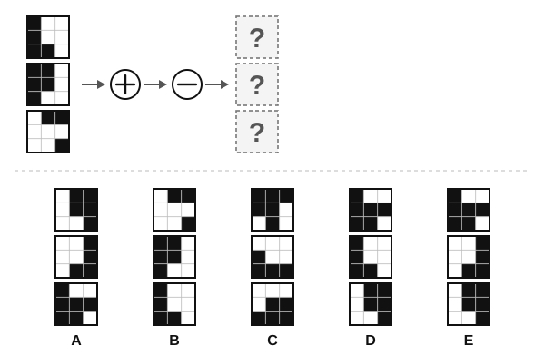
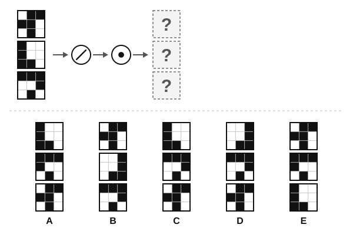
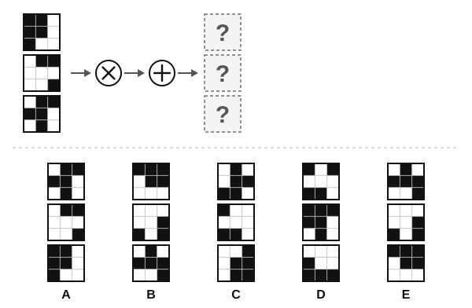
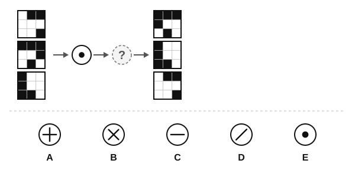
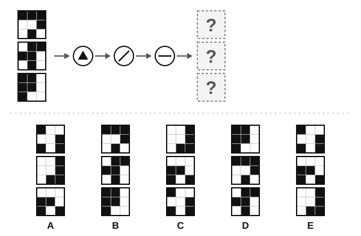

<!-- nav:top -->[目次](../../README.md#目次) · 前へ：[法則性](housokusei.md) · 次へ：[暗号](angou.md)<!-- /nav:top -->

# 命令表

**ひとことで言うと：** 記号ごとに決められた「命令」を覚え、図形の並びに命令を順番どおり実行して、最後にどうなるかを答える科目です。

日本SHLは命令表を、与えられた指示・命令を速く正確に覚えて使いこなす力、つまりコンピュータ言語への適応の度合いを測る科目だと説明しています。プログラムを1行ずつ実行するのとよく似ていて、初めて見ると最も戸惑いやすい科目です。

## 何を測る科目か

見ているのは2つです。1つは、記号と命令の対応を覚えて素早く引き出せるか。もう1つは、命令を1つずつ正しい順番で実行し、途中の状態を見失わないかです。どちらもコードを読み書きするときに欠かせない力です。

## 問題の形

最初に「命令表」が示されます。記号ごとに、図形の並びに対して何をするかが決まっています。各問題では、縦に3つ並んだ図形（上段・中段・下段）に、矢印の順番で命令を実行します。

問われ方は主に2通りです。

- **結果を答える：** 命令を全部実行したあとの並びを、選択肢から選ぶ。
- **抜けた命令を答える：** 最初の並びと最後の並びが示され、途中の「?」に入る命令を選ぶ。

本番の命令の種類や問題の細かい形式は公開されていないので、このガイドでは、よく話題になる「入れ替え」「回転」「反転」「繰り返し」を含む命令表を自作しています。

## このページの命令表

練習問題と[15分診断テスト](../diagnostic.md)の命令表の問題は、すべてこの表を使います。

| 記号 | 命令 |
|---|---|
|  | 上段と下段の図形を入れ替える |
|  | すべての図形を時計回りに90°回転させる |
|  | すべての図形の白黒を反転させる |
|  | 中段の図形だけを左右反転させる |
|  | 図形を1つずつ上へずらす（上段の図形は下段へ） |
|  | 直後の命令を2回続けて実行する |

図形は3×3のマス目で、黒いマスの形が向きを表します。「左右反転」は鏡に映したように左右を入れ替えること、「白黒反転」は黒いマスと白いマスをすべて入れ替えることです。

## 解き方の手順

1. **命令表を先に頭に入れる。** 問題を見る前に、記号と命令の対応をひととおり確認します。本番では同じ表で何問も続くので、最初の30秒をかけておくと、あとで効いてきます。
2. **「位置を変える命令」と「形を変える命令」を分ける。** 入れ替え・ずらしは位置だけ、回転・反転は形だけを変えます。この区別ができると、選択肢を一気に減らせます。
3. **命令を1つずつ実行する。** 頭の中で全部をまとめて処理しようとせず、1つ実行するたびに「上段は何、中段は何、下段は何」と確定させます。
4. **繰り返しの命令は、まとめてから考える。** 「90°回転を2回」は「180°回転」、「白黒反転を2回」は「何もしない」と同じです。
5. **抜けた命令の問題は、差分から考える。** 最初と最後を比べ、位置が変わったのか、形が変わったのか、両方なのかを見ます。そこから候補の命令を絞り、実際に当てはめて確かめます。

## 落としやすいポイント

- **命令の順番を入れ替えてしまう。** 「ずらしてから中段を反転」と「中段を反転してからずらす」では、反転される図形が違います。必ず矢印の順に実行します。
- **全体に効く命令と一部に効く命令の混同。** 「すべての図形」なのか「中段だけ」なのかを、命令表で毎回確認します。
- **ずらす方向の取り違え。** 上へずらすと、上段の図形は下段へ回り込みます。最初のうちは、指で上段・中段・下段を押さえながら確認すると確実です。
- **繰り返し命令の範囲。** 「直後の命令を2回」は、すぐ後ろの1つだけに効きます。その次の命令は1回だけです。
- **回転と反転の取り違え。** 左右反転した図形と90°回転した図形は似て見えることがあります。黒いマスの位置を1つ決めて、それがどこに移ったかで判断します。

## 時間の目安

命令表は1問あたり25秒前後しかないとされています（非公式の情報は[Web-CAB・紙のCAB・C-CABの違い](../formats.md)を参照）。最初の数問は命令表を見返しながらで構いません。後半になるにつれて見返す回数が減り、ペースが上がるのが普通です。

## 練習問題

この5問はこのガイドのために作ったオリジナル問題です。日本SHLの問題や他の対策本・サイトの問題ではありません。上の命令表を使って解いてください。問1〜問3と問5は結果を、問4は「?」に入る命令を、A〜Eから選びます。

### 問1

### 問2

### 問3

### 問4

### 問5

答えと解説（問1〜問5）

**問1：E。** 1つ目の十字の丸で上段と下段を入れ替え、2つ目の横線の丸ですべての図形の白黒を反転します。位置の命令と形の命令が1つずつなので、まず並び順を入れ替えてから、3つとも白黒を反転させた形を探します。*Aではない理由：* 白黒は反転していますが、上段と下段が入れ替わっていません。*Bではない理由：* 入れ替えだけで、白黒反転を忘れています。

**問2：A。** 斜線の丸で図形を1つずつ上へずらすと、元の中段が上段に、元の下段が中段に、元の上段が下段に移ります。そのあと点の丸で、新しい中段（元の下段の図形）だけを左右反転します。*Dではない理由：* 先に中段を反転してからずらした結果で、反転される図形が違います。順番どおりに実行するのが大事な問題です。*Cではない理由：* ずらしただけで、左右反転をしていません。

**問3：E。** ×の丸ですべての図形を時計回りに90°回転させてから、十字の丸で上段と下段を入れ替えます。*Aではない理由：* 入れ替えだけで、回転していません。*Bではない理由：* 回転だけで、入れ替えていません。*Cではない理由：* 回転を2回（180°）してしまった形です。

**問4：D（斜線の丸）。** 最初と最後を比べると、3つの図形の並び順が変わっています。最初の中段にあった図形は、最後には上段にあり、しかも左右反転しています。点の丸で中段を左右反転したあと、斜線の丸で1つずつ上へずらすと、ちょうど最後の並びになります。*Aではない理由：* 十字の丸は上段と下段の入れ替えなので、中段の図形は中段に残ります。*B、Cではない理由：* 回転や白黒反転は形を変えるだけで、並び順は変わりません。

**問5：C。** 三角の丸は直後の命令を2回実行するので、斜線の丸で2回上へずらします。1回目で元の中段が上段に、2回目で元の下段が上段に来ます。つまり並びは「元の下段、元の上段、元の中段」の順です。最後に横線の丸で、すべての白黒を反転します。*Aではない理由：* ずらしを1回しかしていません。*Bではない理由：* 三角の丸を「横線の丸を2回」と読んだ結果で、白黒が2回反転して元の図形に戻っています。*Dではない理由：* 白黒反転を忘れています。

もっと解きたい人へ：PrepClubsの無料CAB形式模擬テストは、暗算・法則性・命令表・暗号の4科目で全179問あり、全問に解説が付いています。[CAB形式の無料模擬テスト（PrepClubs）](https://prepclubs.com/ja/cab-taisaku?utm_source=github&utm_medium=referral&utm_campaign=study-notes&utm_content=cab)

## 採点表

| 問 | 1 | 2 | 3 | 4 | 5 |
|---|---|---|---|---|---|
| 答え | E | A | E | D | C |

- **5問正解：** 命令を順に実行する型はできています。本番では命令の種類が増えるので、命令表を覚える速さを意識しましょう。
- **4問正解：** 外した問題が「順番」（問2）か「繰り返し」（問5）かを確認してください。どちらも手順3と4で防げます。
- **3問以下：** 1つ命令を実行するたびに、上段・中段・下段を紙に書き出す練習から始めてください。慣れてきたら書く量を減らし、最後は頭の中だけで追えるようにします。

## 次のステップ

命令表は、慣れるまでの差が最も大きい科目です。時間を計った通しの練習は[CAB形式の無料模擬テスト（PrepClubs）](https://prepclubs.com/ja/cab-taisaku?utm_source=github&utm_medium=referral&utm_campaign=study-notes&utm_content=cab)でできます。間違えた問題は、どの命令の実行でずれたかまで特定しておきましょう。

---

<!-- nav:bottom -->← 前へ：[法則性](housokusei.md) | 次へ：[暗号](angou.md) → | [目次へ戻る](../../README.md#目次)<!-- /nav:bottom -->
